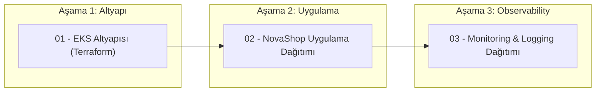

# NovaShop EKS altyapısı

Bu dizin, NovaShop eğitim ortamı için AWS VPC, iki kullanılabilirlik alanında private EKS node'ları, ECR ve AWS Load Balancer Controller'ı Terraform ile oluşturur. Uygulama bu Terraform katmanıyla değil, ayrı GitHub Actions işindeki Helm komutuyla yayımlanır.

## Oluşturulan kaynaklar

- İki public ve iki private subnet, Internet Gateway ve maliyeti azaltmak için tek NAT Gateway
- EKS `managed node group` (varsayılan iki `t3.small` node)
- Private ve immutable `novashop-ui` ECR deposu; push sonrası image taraması
- EKS OIDC/IRSA ve AWS Load Balancer Controller Helm kurulumu
- ALB için gerekli subnet etiketleri

## 0. Zorunlu ön hazırlık: Terraform state bucket'ı

Terraform state bucket'ı **Terraform workflow'undan önce** oluşturulmalıdır; S3 backend, henüz mevcut olmayan kendi bucket'ını oluşturamaz. Aşağıdaki örnek varsayılan `us-east-1` bölgesi içindir. Bucket adı AWS genelinde benzersiz olmalıdır.

```bash
export AWS_REGION=us-east-1
export TF_STATE_BUCKET=benzersiz-novashop-tf-state-ACCOUNT_ID

aws s3api create-bucket --bucket "$TF_STATE_BUCKET" --region "$AWS_REGION"
aws s3api put-bucket-versioning --bucket "$TF_STATE_BUCKET" \
  --versioning-configuration Status=Enabled
aws s3api put-bucket-encryption --bucket "$TF_STATE_BUCKET" \
  --server-side-encryption-configuration '{"Rules":[{"ApplyServerSideEncryptionByDefault":{"SSEAlgorithm":"AES256"}}]}'
aws s3api put-public-access-block --bucket "$TF_STATE_BUCKET" \
  --public-access-block-configuration BlockPublicAcls=true,IgnorePublicAcls=true,BlockPublicPolicy=true,RestrictPublicBuckets=true
```

`us-east-1` dışında bir bölge kullanırsanız `create-bucket` komutuna ilgili `LocationConstraint` eklenmelidir. Oluşturduğunuz bucket adını GitHub'da `TF_STATE_BUCKET` variable'ına girin. Workflow state'i `novashop/eks/terraform.tfstate` anahtarında, S3 native lockfile ile kilitli tutar.

## 1. Diğer ön koşullar

Bu eğitim akışı Pluralsight AWS laboratuvarı için GitHub Secrets'taki erişim anahtarlarıyla çalışır. Terraform'u ilk çalıştıran IAM kullanıcısı EKS cluster administrator erişimini alır; uygulama deploy workflow'u da aynı anahtarlarla bağlandığı için `kubectl` ve Helm kullanabilir.

## 2. GitHub ayarları

Repository **Settings → Secrets and variables → Actions** bölümünde aşağıdaki değişkenler tanımlanmalıdır:

### AWS ve Terraform Bilgileri

| Tür | Ad | Açıklama |
| --- | --- | --- |
| Secret | `AWS_ACCESS_KEY_ID` | Pluralsight IAM kullanıcısının access key değeri |
| Secret | `AWS_SECRET_ACCESS_KEY` | Pluralsight IAM kullanıcısının secret access key değeri |
| Variable | `AWS_REGION` | AWS bölgesi (örn. `us-east-1`) |
| Variable | `TF_STATE_BUCKET` | Önceden oluşturulan benzersiz S3 bucket adı |
| Variable | `EKS_CLUSTER_NAME` | Varsayılan: `novashop-training` |

### Cloudflare ve DNS Bilgileri (Monitoring & Domain Yönlendirme)

| Tür | Ad | Açıklama |
| --- | --- | --- |
| Secret | `CLOUDFLARE_API_TOKEN` | Cloudflare API Token (`Zone.DNS:Edit` yetkili) |
| Secret | `CLOUDFLARE_ZONE_ID` | `devopsatolyesi.com` domainine ait Cloudflare Zone ID |
| Variable | `BASE_DOMAIN` | Temel alan adı (Varsayılan: `devopsatolyesi.com`) |

`EKS_CLUSTER_NAME`, `project=novashop` ve `environment=training` değerlerinden gelir. Bu değerleri değiştirirseniz workflow variable'ını da aynı isimle güncelleyin. Pluralsight ortamı büyük instance'lara izin vermediği için varsayılan node tipi `t3.small` seçilmiştir.

## 3. Çalıştırma Sırası ve Sıfırdan Otomatik Kurulum (Clean Slate / Disaster Recovery)

Tüm altyapı, uygulamalar ve gözlemlenebilirlik araçları **%100 Kod Olarak Altyapı (IaC)** prensibiyle hazırlanmıştır. Ortam tamamen silinse (`destroy`) dahi, hiçbir manuel terminal/kubectl komutuna gerek kalmadan aşağıdaki 3 GitHub Actions iş akışı sırayla tetiklenerek sistem baştan sona kurulur:



### 1. Aşama: `01 - EKS Altyapısı (Terraform)`
- **Tetikleme:** `workflow_dispatch` üzerinden `action: apply`.
- **Otomatik Yapılanlar:**
  - AWS VPC (2 Public, 2 Private Subnet, Tek NAT Gateway).
  - EKS Cluster (Kubernetes v1.37.1) ve Managed Node Group (4 x `t3.small`).
  - Pod kapasitesini node başına 11'den 44'e çıkaran **VPC-CNI Prefix Delegation** (`ENABLE_PREFIX_DELEGATION=true`).
  - EKS Eklentileri: `vpc-cni`, `kube-proxy`, `coredns`, `eks-pod-identity-agent`, `metrics-server`.
  - **AWS Load Balancer Controller** (IAM Rolü, Politika ve Helm Release otomatik kurulur).
  - Private `novashop-ui` ECR deposu.

### 2. Aşama: `02 - NovaShop EKS Uygulama Dağıtımı`
- **Tetikleme:** `workflow_dispatch`.
- **Otomatik Yapılanlar:**
  - `src/ui` kodunu derler, Docker imajını oluşturur ve ECR'a gönderir.
  - Helm ile `novashop` namespace'ine 5 mikroservisi dağıtır: `ui`, `catalog`, `cart`, `orders`, `checkout`.
  - UI için Horizontal Pod Autoscaler (HPA) devreye girer (Min: 1, Max: 4 pod, %70 CPU eşiği).
  - `devopsatolyesi-shared` Ingress grubuna dahil `novashop-ingress` oluşturulur.
  - Paylaşımlı AWS Application Load Balancer (ALB) oluşturulmasını bekler ve `/actuator/health` kontrolüyle doğrular.

### 3. Aşama: `03 - Monitoring & Logging Dağıtımı`
- **Tetikleme:** `workflow_dispatch` üzerinden `action: apply`.
- **Otomatik Yapılanlar:**
  - `logging` ve `monitoring` namespace'lerini açar.
  - **Elastic Stack 9 (ELK 9):**
    - Elasticsearch 9.5.5 (StatefulSet, single-node, 350m heap, Hard PodAntiAffinity).
    - Logstash 9.5.5 (Beats pipeline, 180m heap, Elasticsearch çıktısı).
    - Fluent Bit 3.2.4 (Her node'da DaemonSet, container loglarını toplar ve Logstash'e iletir).
    - Kibana 9.5.5 (768m old-space-size, Elasticsearch bağlantısı, Hard PodAntiAffinity).
  - **Prometheus & Grafana:**
    - Prometheus (K8s node, cadvisor ve servis metriklerini toplar).
    - Grafana 11.5.2 (Datasource'lar: Prometheus & Elasticsearch; Hazır Dashboard: `NovaShop — Microservices RED & Business Overview`).
  - **Paylaşımlı ALB Ingress:** Tüm izleme araçlarını tek bir ALB arkasında toplar.
  - **Cloudflare DNS Senkronizasyonu:** Cloudflare APIv4 kullanarak aşağıdaki CNAME kayıtlarını otomatik oluşturur ve günceller:
    - `novashop.devopsatolyesi.com` ➔ NovaShop Mağaza
    - `elk.devopsatolyesi.com` ➔ Kibana Log Analizi
    - `grafana.devopsatolyesi.com` ➔ Grafana Metrik Panoları
    - `prometheus.devopsatolyesi.com` ➔ Prometheus Paneli

---

## 4. Servis Erişimleri ve Varsayılan Bilgiler

| Servis Adı | Domain Adresi | Varsayılan Kullanıcı | Varsayılan Şifre | Açıklama |
|---|---|---|---|---|
| **NovaShop Store** | `http://novashop.devopsatolyesi.com` | - | - | E-ticaret ön yüzü ve mikroservis vitrini |
| **Grafana** | `http://grafana.devopsatolyesi.com` | `admin` | `devops2026` | Metrik dashboard'ları (NovaShop hazır paneli yüklü) |
| **Kibana (ELK 9)** | `http://elk.devopsatolyesi.com` | - | - | Merkezi loglama (`k8s-logs-*` veri görünümü) |
| **Prometheus** | `http://prometheus.devopsatolyesi.com` | - | - | Ham metrik sorgulama ve target durumu |

> [!NOTE]
> **Paylaşımlı ALB Grubu:** Tüm servisler `alb.ingress.kubernetes.io/group.name: devopsatolyesi-shared` etiketini kullanır. AWS Load Balancer Controller bu sayede 4 farklı ALB açmak yerine **tek bir ALB** üzerinde host bazlı yönlendirme (routing rules) yapar; bu da Pluralsight bütçesinin aşılmasını engeller.

---

## 5. Laboratuvarı Temizleme (Tear Down)

Eğitim veya çalışma tamamlandığında maliyet oluşmaması için:
1. `03 - Monitoring & Logging Dağıtımı` workflow'unu `action: destroy` ile çalıştırarak monitoring kaynaklarını ve Ingress kurallarını kaldırın.
2. `01 - EKS Altyapısı (Terraform)` workflow'unu `action: destroy` seçeneğiyle çalıştırarak EKS, NAT Gateway ve VPC bileşenlerini tamamen temizleyin.

## Güvenlik notu

EKS API endpoint'i GitHub-hosted runner'ın erişebilmesi için public'tir; erişim IAM ile korunur. Bu access key yaklaşımı eğitim içindir. Gerçek üretim ortamında GitHub OIDC, sınırlı IAM rolü, self-hosted runner ve CIDR ile sınırlandırılmış endpoint kullanın.
